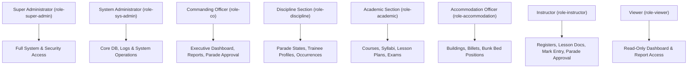
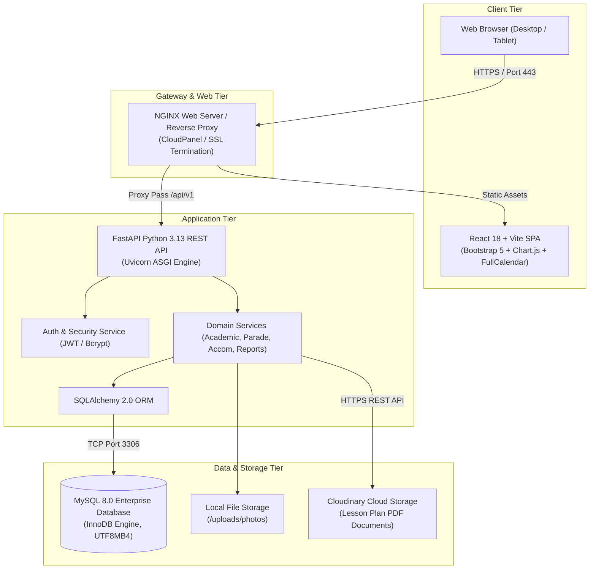
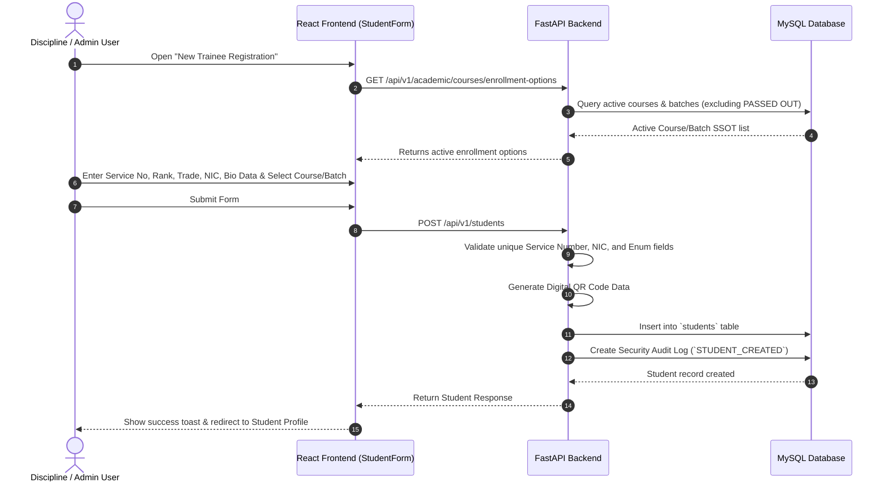
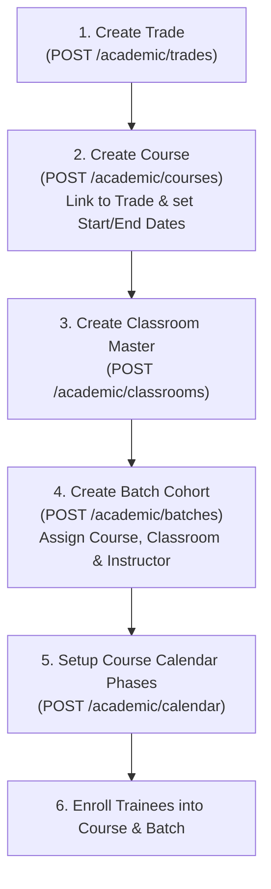
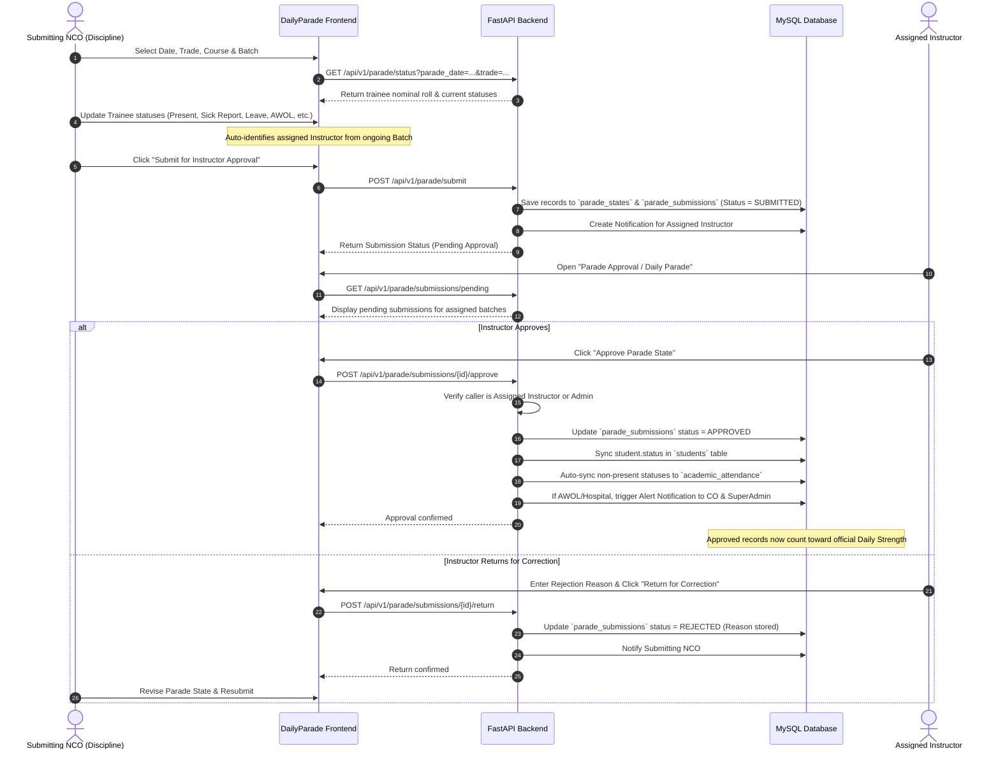
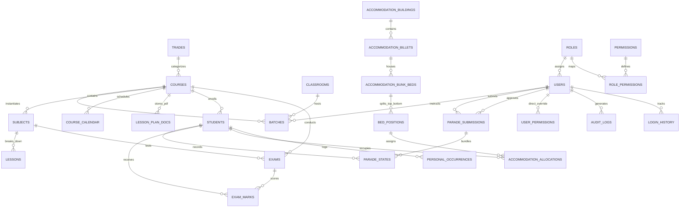

# SRI LANKA AIR FORCE TRADE TRAINING SCHOOL (SLAF TTS)
# MASTER SYSTEM DOCUMENTATION (MD.md)

---

## 1. Document Information

| Attribute | Specification |
| :--- | :--- |
| **Project Name** | Sri Lanka Air Force Trade Training School (TTS) Management Portal |
| **Document Title** | Master System Documentation (MD) |
| **Document Purpose** | Comprehensive architectural and functional reference for system development, operation, governance, and onboarding. |
| **Version** | 1.0.0 |
| **Status** | Approved / Operational Baseline |
| **Security Classification** | RESTRICTED — Official SLAF TTS Internal Use Only |
| **Primary Technology Stack** | React.js (Vite) / Python (FastAPI) / MySQL 8.0 (SQLAlchemy ORM) / Docker / Oracle Cloud VPS / Cloudinary |

---

## 2. Project Overview

The **Sri Lanka Air Force (SLAF) Trade Training School (TTS)** Management Portal is an enterprise-grade, secure, web-based management information system and Single Source of Truth (SSOT). The portal streamlines, standardizes, and automates military vocational training workflows, academic administration, trainee tracking, daily strength accountability, accommodation billeting, disciplinary reporting, and executive reporting for the Sri Lanka Air Force.

Prior to the introduction of this portal, critical training operations across technical and non-technical air force trades relied on fragmented manual ledgers, physical paper nominal rolls, isolated spreadsheets, and redundant data entry. The TTS Management Portal consolidates these disconnected functions into an integrated digital environment designed specifically around military chain-of-command protocols, rigorous role-based access control (RBAC), and strict data auditability.

---

## 3. Organization and System Background

The Sri Lanka Air Force Trade Training School is the premier vocational and technical training establishment responsible for qualifying Airmen and Airwomen in specialized aeronautical, electronic, mechanical, administrative, and logistical trades. 

### Training Pipeline Hierarchy
The training structure follows a strict organizational hierarchy:
1. **Trade**: The specialized military occupational specialty (e.g., Airframe, Avionics, Safety Equipment, Engine, Logistical, Administrative).
2. **Course**: The formal syllabus program mapped to a Trade (e.g., Basic Airframe Mechanics Course, duration 24 weeks).
3. **Batch (Intake)**: The specific trainee cohort enrolled in a Course (e.g., Batch 2026-A), assigned to a dedicated Classroom and an assigned Instructor.
4. **Trainee (Student)**: The enlisted military personnel (Service Number, Rank, Name, Trade) undergoing training within the Batch.

### Military Operational Context
In addition to academic training, military discipline and daily muster accountability are vital. Daily strength muster ("Parade State") must be taken each morning before training activities commence. Trainees on Sick Report, Hospitalized, on Approved Leave, or Absent Without Official Leave (AWOL) must be immediately accounted for, with their daily status automatically cascading into classroom attendance and examination eligibility.

---

## 4. Problem Statement

Before the deployment of the TTS Management Portal, TTS operations faced several operational bottlenecks:
1. **Information Silos**: Student personnel records, accommodation registries, lesson plan files, and marks sheets were maintained in separate physical books or local spreadsheets.
2. **Daily Strength Delays**: Morning parade muster figures took hours to manually consolidate from different billets and trade schools, delaying operational strength reporting to the Commanding Officer.
3. **Attendance & Examination Inconsistencies**: Disciplinary absence (e.g., hospital admission or AWOL) was not instantly synchronized with classroom attendance registers, allowing ineligible trainees to potentially appear on exam rolls.
4. **Assessment & Progress Tracking Gaps**: Tracking a trainee's academic progression across successive Phase Tests required manual marksheet collation, with no automated trend analysis or early warning for struggling students.
5. **Accommodation Misallocations**: Manual bed allocation led to double-booking of bunk bed positions, unmonitored billet vacancies, and difficulty locating trainees during emergency muster.
6. **Lack of Auditability**: Historical modifications to student marks, attendance entries, and user accounts lacked immutable security audit trails.

---

## 5. Project Objectives

1. **Establish a Single Source of Truth (SSOT)**: Maintain a single canonical data model for every trainee, course, instructor, billet, and assessment record.
2. **Automate Parade State & Daily Strength**: Provide two-stage digital parade submission with automatic instructor resolution and instantaneous cascading to classroom attendance.
3. **Streamline Academic Lifecycle Management**: Enable end-to-end administration of Trades, Courses, Batches, Subjects, Lessons, Cloudinary-hosted Lesson Plan PDFs, Course Calendars, and Timetables.
4. **Provide Chronological Academic Progression**: Track and visualize trainee Phase Test performance over time using structured metrics and line charts.
5. **Automate Accommodation & Bed Allocation**: Provide interactive billeting maps supporting physical bunk bed top/bottom position tracking.
6. **Enforce Military-Grade Security & Governance**: Enforce JSON Web Token (JWT) authentication, granular RBAC, account locking, password history restrictions, and comprehensive audit logging.
7. **Generate Standardized Formal SLAF Reports**: Produce publication-ready official reports (PDF and Excel) matching Sri Lanka Air Force formatting standards.

---

## 6. System Scope

### In Scope
- **Trainee Personnel Management**: Master profiles, service data, emergency contacts, medical classification, and digital QR badge generation.
- **Academic Management**: Trade registry, Course lifecycle, automated Batch closure, Classroom masters, Subject syllabi, Lessons, Cloud-hosted Lesson Plans, Course Calendars, and Timetables.
- **Assessment & Examination Engine**: Phase Tests, Final Examinations, marks entry, pass/fail grading, eligibility override workflows, and Marks Sheets.
- **Academic Progress Tracking**: Chronological Phase Test progression, dynamic line chart visualization, performance KPIs, and result history.
- **Daily Parade State & Muster**: Trade-level morning parade muster, auto-instructor routing, two-stage approval/rejection workflows, outstanding monitoring, and daily strength computation.
- **Classroom Attendance Registry**: Timetable-period attendance tracking with automated parade state synchronization.
- **Accommodation Management**: Buildings, Billets, Bunk Beds (Top/Bottom positions), vacancy tracking, bed allocations, transfers, and vacating.
- **Personal Occurrence Reporting**: Trainee achievements, commendations, disciplinary infractions, and punishment logging.
- **Enterprise Reporting**: Dedicated server-side compiled PDF/Excel reports with official SLAF headers and signatures.
- **System Administration & Security**: User provisioning, RBAC, direct permission overrides, session audit logs, and login histories.

### Out of Scope
- Direct integration with central SLAF Directorate of Electronic & Air Engineering or Air Force Headquarters (AFHQ) Mainframe ERP (data exported via standard reports/Excel).
- Automatic biometric fingerprint/facial recognition scanners (QR code scanner supported via camera/scanner hardware).
- Financial accounting, trainee payroll, or allowances management.
- Inventory tracking of aircraft spare parts, tools, or weapons armory.

---

## 7. Stakeholders

| Stakeholder Group | Role & Responsibilities | Key Interests |
| :--- | :--- | :--- |
| **Commanding Officer (CO)** | Executive Head of SLAF TTS | High-level operational strength, training pass rates, discipline oversight, executive dossiers. |
| **Officer Commanding Training (OCT) / Academic Section** | Head of Academic & Syllabus Execution | Course calendars, syllabus completion, instructor assignments, exam results, marksheets. |
| **Discipline Section / NCOs** | Daily Muster & Student Welfare | Morning parade states, strength muster, AWOL tracking, personal occurrence reporting. |
| **Accommodation Officer** | Living Quarters Custodian | Billet occupancy, bunk bed maintenance, accommodation allocation and vacancy optimization. |
| **Instructors** | Direct Classroom Teachers | Timetable attendance, lesson plan document management, examination marking, parade approvals. |
| **Trainees / Students** | Vocational Course Participants | Academic progression, examination grades, accommodation allocation. |
| **System Administrators** | IT Officers / Technical Administrators | User accounts, security policies, database integrity, backups, CI/CD, system health. |

---

## 8. User Roles and Responsibilities

The system enforces eight standard roles seeded into the database:



### Detailed Role Matrix

| Role Name | System Role ID | Core Responsibilities | Permissions Assigned |
| :--- | :--- | :--- | :--- |
| **Super Administrator** | `role-super-admin` | Full system control, role/permission configuration, user management, backups, security audits. | All permissions (`*`) |
| **System Administrator** | `role-sys-admin` | Technical administration, user account maintenance, audit log reviews, batch automation monitoring. | All permissions (`*`) |
| **Commanding Officer** | `role-co` | Executive visibility over training health, daily strength approvals, formal dossier inspection. | `student:read`, `parade:read`, `parade:approve`, `reports:read`, `personal_occurrence:read` |
| **Discipline Section** | `role-discipline` | Daily parade muster submission, student master profile management, personal occurrences logging. | `student:read`, `student:write`, `parade:read`, `parade:write`, `parade:approve`, `parade:manage_officers`, `reports:read`, `personal_occurrence:*` |
| **Academic Section** | `role-academic` | Course creation, syllabus and lesson setup, batch management, exam scheduling, mark sheets. | `student:read`, `academic:read`, `academic:write`, `reports:read`, `parade:read` |
| **Accommodation Officer** | `role-accommodation` | Billets and bunk bed configurations, room allocation registers, transfer and vacancy logs. | `student:read`, `room:read`, `room:write`, `reports:read`, `parade:read` |
| **Instructor** | `role-instructor` | Timetable registers, lesson plan upload, exam mark recording, ongoing batch parade approvals. | `student:read`, `academic:read`, `academic:write`, `parade:read`, `parade:write`, `parade:approve`, `personal_occurrence:read`, `personal_occurrence:write`, `reports:read` |
| **Viewer** | `role-viewer` | Read-only inspection of dashboards, student rosters, and general summary reports. | `student:read`, `parade:read`, `reports:read` |

---

## 9. Overall System Architecture

The TTS Management Portal is architected as a modular, decoupled, three-tier enterprise web application containerized with Docker:



---

## 10. Complete Module Overview

The table below outlines all functional modules within the TTS Management Portal, explicitly categorizing their implementation status:

| Module Name | Implementation Status | Functional Description |
| :--- | :--- | :--- |
| **Executive Dashboard** | `[IMPLEMENTED]` | Live strength cards, academic KPIs, attendance rates, billet occupancy, notification feeds, quick links. |
| **Trainee Details Management** | `[IMPLEMENTED]` | Student directory, search/filtering, registration, profile editing, photo upload, digital QR card generation. |
| **Trainee Personal Profile** | `[IMPLEMENTED]` | Comprehensive view showing military service, emergency contact, medical category, and photo. |
| **Personal Academic Profile** | `[IMPLEMENTED]` | Integrated trainee academic record showing enrolled course, batch, trade, and phase performance. |
| **Academic Progress** | `[IMPLEMENTED]` | Chronological Phase Test progression, Chart.js line chart (0–100%), summary KPIs, and detailed table. |
| **Trade Management** | `[IMPLEMENTED]` | CRUD management of SLAF vocational trades (Airframe, Avionics, Safety Equipment, Engine, etc.). |
| **Course Management** | `[IMPLEMENTED]` | Course catalog, start/end dates, duration in weeks, intake capacities, trade mappings, status tracking. |
| **Batch Management** | `[IMPLEMENTED]` | Batch cohorts, classroom assignments, designated instructors, active/passed-out states. |
| **Automated Batch Closure** | `[IMPLEMENTED]` | Background scheduled worker and manual trigger to auto-close expired courses (`end_date < today`). |
| **Instructor Assignment** | `[IMPLEMENTED]` | Single Source of Truth linking user accounts (`role-instructor`) to courses, batches, and calendar phases. |
| **Classroom Management** | `[IMPLEMENTED]` | Master registry of physical lecture halls and laboratories with block, building, and capacity limits. |
| **Course Calendar Management** | `[IMPLEMENTED]` | Phase-by-phase course timeline, theory/practical periods, working days, date validation, instructor status. |
| **Lesson Plan Management** | `[IMPLEMENTED]` | Subject and lesson definitions, teaching objectives, training aids, references, and timetable slots. |
| **Lesson Plan Documents (Cloudinary)** | `[IMPLEMENTED]` | Cloudinary PDF upload, versioning, mime validation, size limits (20MB), preview, and download. |
| **Parade State Management** | `[IMPLEMENTED]` | Morning trade parade muster, draft saving, automatic instructor identification, two-stage submit/approve. |
| **Outstanding Parade State Monitoring** | `[IMPLEMENTED]` | Real-time monitoring of unsubmitted, pending, approved, and returned parade states across dates. |
| **Instructor Parade State Approval** | `[IMPLEMENTED]` | Instructor review, one-click approval with downstream sync, or return for correction with remarks. |
| **Classroom Attendance Registry** | `[IMPLEMENTED]` | Daily classroom attendance tracking (valid for the full day, period selection not required) with automated parade state synchronization. |
| **Examination Management** | `[IMPLEMENTED]` | Phase Test and Final Exam scheduling, max/pass marks, marksheet entry, grading, eligibility overrides. |
| **Accommodation Management** | `[IMPLEMENTED]` | Bunk bed management (Top/Bottom positions), billet capacities, visual vacancy maps, allocations, transfers. |
| **Personal Occurrence Reporting** | `[IMPLEMENTED]` | Recording trainee achievements, commendations, misconduct, and offenses with formal dossier export. |
| **Enterprise Reports & Export** | `[IMPLEMENTED]` | Server-side compiled classical PDF and Excel reports (Dossiers, Strength, Marksheets, Attendance, Billets). |
| **User Management & RBAC** | `[IMPLEMENTED]` | User lifecycle, password policy enforcement, account locking, password history reuse prevention, audit logging. |
| **Audit & Login History** | `[IMPLEMENTED]` | Immutable audit log capturing IP, User Agent, action, and changes; login history with success/lock tracking. |
| **Biometric Attendance Integration** | `[FUTURE]` | Direct hardware integration with fingerprint/facial recognition terminals. |
| **Trainee Self-Service Mobile Portal** | `[FUTURE]` | Mobile app for trainees to view their own timetables, grades, and notices. |

---

## 11. Major System Workflows

### 11.1 Trainee Registration & Course Enrollment Workflow



### 11.2 Trade → Course → Batch → Instructor / Classroom Setup



### 11.3 Parade State: Submission → Instructor Approval → Daily Strength



### 11.4 Examination → Results → Academic Progress Progression

```mermaid
flowchart TD
    ScheduleExam["1. Schedule Exam / Phase Test\n(POST /academic/exams)"] --> MarkEntry["2. Record Marks per Student\n(POST /academic/exams/{id}/marks)"]
    MarkEntry --> CheckEligibility{"Is Trainee Eligible?\n(Parade Status Check)"}
    CheckEligibility -->|Eligible (Present)| SaveMark["Save Marks & Compute Status (Pass/Fail)"]
    CheckEligibility -->|Ineligible (Sick/Leave/AWOL)| MarkStatus["Set Status to Absent/Sick\n(Marks = 0)"]
    MarkStatus --> Override{"Authorized Officer Override?"}
    Override -->|Yes| OverrideMark["Set is_overridden=True,\nrecord reason & authorizer"] --> SaveMark
    Override -->|No| SaveMark
    SaveMark --> WriteDB[("Write to `exam_marks` table")]
    WriteDB --> AutoProgress["3. Instant Trainee Academic Progress API\n(GET /students/{id}/academic-progress)"]
    AutoProgress --> RenderChart["Render Chronological Line Chart (0-100%)\n& Compute Cumulative KPIs"]
```

---

## 12. Business Rules Summary

| Rule ID | Domain | Business Rule Statement |
| :--- | :--- | :--- |
| **BR-TRN-001** | Trainees | Service Number must be unique across the entire Air Force database. Duplicate entries are blocked at DB level. |
| **BR-TRN-002** | Trainees | A trainee can only be enrolled in active courses. Passed-out courses cannot accept new enrollments. |
| **BR-PAR-001** | Parade State | Submitting operators cannot manually pick an arbitrary approving instructor. The instructor is auto-resolved from Batch assignment. |
| **BR-PAR-002** | Parade State | Only the designated ongoing course instructor (or Super/System Admin / CO) is authorized to approve a submitted parade state. |
| **BR-PAR-003** | Parade State | Historical parade state records retain the original approving officer ID permanently, even if batch assignments later change. |
| **BR-PAR-004** | Parade State | Only **APPROVED** parade state records reflect in official Daily Strength dashboards and reports. DRAFT/SUBMITTED records are marked unverified. |
| **BR-PAR-005** | Parade State | Approving a parade state automatically syncs trainee master status and flags non-present trainees as Excused/Absent in that day's timetable. |
| **BR-EXM-001** | Assessment | Trainees on Sick Report, Hospital, Leave, Course Visit, Detached Duty, or AWOL on exam date cannot sit exams unless formally overridden by an authorized officer. |
| **BR-EXM-002** | Assessment | Marks percentage is strictly computed as `(obtained_marks / max_marks) * 100`. No fabricated or hardcoded results are permitted. |
| **BR-ACC-001** | Accommodation | A single bed position (`TOP` or `BOTTOM`) can only hold one active trainee allocation at any given time. |
| **BR-ACC-002** | Accommodation | Vacating or transferring a bed immediately frees the position to `Available` status and archives previous allocation to history. |
| **BR-SEC-001** | Security | Passwords must be at least 12 characters and include uppercase, lowercase, number, and special character. |
| **BR-SEC-002** | Security | Accounts lock automatically after 5 consecutive failed login attempts and require administrator unlocking. |
| **BR-SEC-003** | Security | Password reuse is blocked for the last 5 historically used passwords per user account. |

---

## 13. Data Relationships (SSOT Architecture)



---

## 14. Security and Access Control

1. **Authentication Mechanism**: Stateless JSON Web Tokens (JWT) signed via HMAC-SHA256 (`HS256`).
2. **Access Token Lifespan**: 60 minutes; Refresh Token Lifespan: 7 days.
3. **Password Security**: Salted Bcrypt hashing with minimum work factor 12.
4. **Backend Authorization**: FastAPI `PermissionChecker` dependency injection guarding every REST endpoint.
5. **SQL Injection Defense**: Strict SQLAlchemy 2.0 ORM parameterized query binding.
6. **Cross-Site Scripting (XSS) Defense**: React JSX auto-escaping and sanitized output binding.
7. **Cross-Origin Resource Sharing (CORS)**: Configured in FastAPI middleware.

---

## 15. Reporting and Printing Requirements

All system reports are generated dynamically from live database queries using server-side rendering engines (ReportLab for PDF and OpenPyXL for Excel).

### Classical Formal Report Guidelines
- **No Raw Window.Print**: Reports must not rely on simple unformatted `window.print()` dumps of the active browser screen.
- **A4 Layout Standards**: Standard A4 dimensions in Portrait or Landscape orientation depending on column count.
- **Official SLAF Masthead**: Formal bilingual emblem, establishment title ("SRI LANKA AIR FORCE TRADE TRAINING SCHOOL"), report title, and generation timestamp.
- **Summary & Detailed Tables**: KPI boxes followed by striped, bordered data tables with repeating headers on multi-page documents.
- **Signature & Endorsement Blocks**: Formal military signature lines for Officer I/C, Submitting NCO, and Commanding Officer.

---

## 16. Audit Requirements

1. **Audit Logs (`audit_logs`)**: Automatically captures user ID, username, action type, IP address, user agent, module, and detailed message for every state-altering mutation.
2. **Login History (`login_history`)**: Records every authentication attempt with timestamp, IP address, user agent, status (`SUCCESS`, `FAILED`, `LOCKED`), and logout time.
3. **Soft-Delete Preservation**: Critical entities (Students, Courses, Occurrences, Users) utilize soft-deletion (`deleted_at`), ensuring records are never permanently removed from historical audit queries.

---

## 17. Non-Functional Requirements

- **Response Time**: 95% of API requests respond in less than 200 milliseconds under standard load.
- **Availability**: 99.5% uptime during operational training hours.
- **Scalability**: Designed to handle 5,000+ active trainees, 500+ daily muster submissions, and 100 concurrent operators.
- **Data Integrity**: Enforced Foreign Key constraints, database transactions, and ACID compliance on InnoDB engine.

---

## 18. Future Development Roadmap

1. **Biometric Muster Terminals**: Direct integration with hardware fingerprint/face scanners for instantaneous automated muster verification.
2. **Trainee Mobile Portal**: Progressive Web Application (PWA) allowing trainees to check their individual timetable, phase test results, and accommodation status.
3. **E-Learning & CBT Module**: Online examination testing engine with automated multiple-choice scoring and question banks.

---

## 19. System Acceptance Criteria

1. All functional modules operate without fatal runtime errors or data corruption.
2. Parade state submission automatically resolves the ongoing batch instructor and prevents unauthorized approvals.
3. Approved parade states accurately update the live Daily Strength counter and sync with classroom attendance.
4. Trainee Academic Progress displays an accurate, chronologically ordered line chart and KPI summary from live `exam_marks` data.
5. All security policies (account locking, password history, RBAC endpoint guards) are strictly enforced.
6. Formal PDF and Excel reports download cleanly with authentic SLAF TTS headers and pagination.
