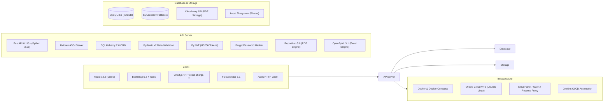
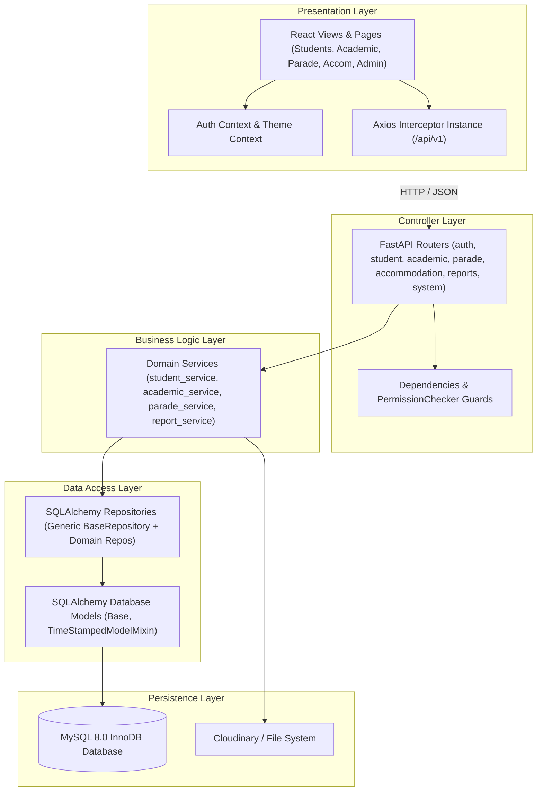
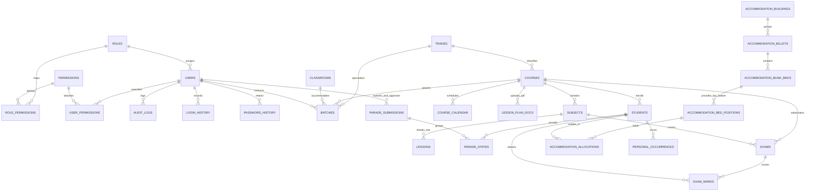
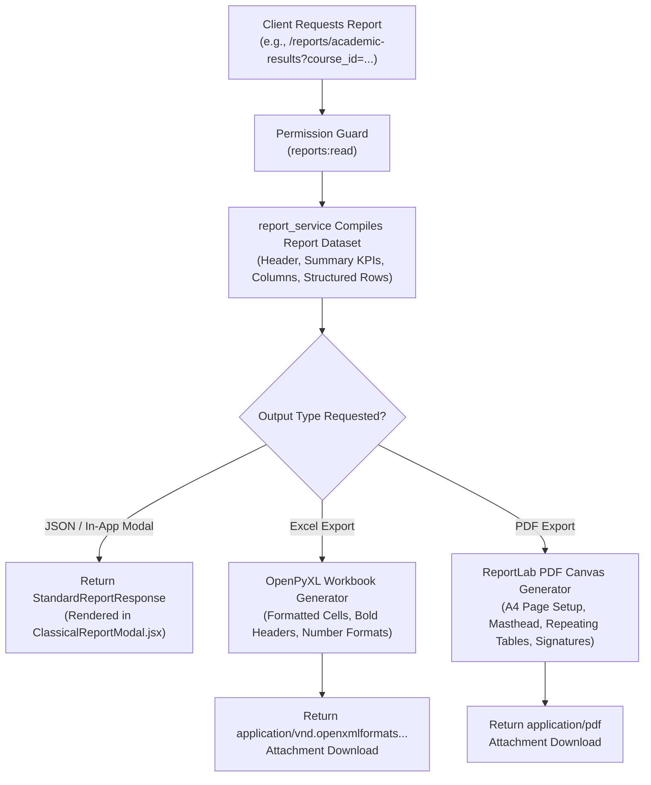

# SRI LANKA AIR FORCE TRADE TRAINING SCHOOL (SLAF TTS)
# TECHNICAL REQUIREMENTS DOCUMENT (TRD.md)

---

## 1. Technical Overview

The **Sri Lanka Air Force (SLAF) Trade Training School (TTS) Management Portal** is a production-grade, secure, multi-tier enterprise web application. It is engineered with a **React.js 18 Single Page Application (SPA)** frontend, a **Python 3.13 FastAPI** asynchronous REST API backend, and a **MySQL 8.0 InnoDB** relational database.

This Technical Requirements Document (TRD) specifies **HOW** the system is implemented, detailing the concrete software architecture, database schema, entity relationships, REST API catalog, security controls, CI/CD pipeline, Docker containerization, and Oracle Cloud VPS deployment infrastructure.

---

## 2. Technology Stack



### Stack Component Details

| Layer | Technology | Version | Purpose |
| :--- | :--- | :--- | :--- |
| **Frontend Framework** | React.js | `^18.2.0` | Component-based reactive UI rendering. |
| **Frontend Build Tool** | Vite | `^5.1.6` | Fast development server and optimized ES module bundling. |
| **UI Styling & Icons** | Bootstrap / Bootstrap Icons | `^5.3.3` / `^1.11.3` | Responsive layout grids, components, and standard icons. |
| **Charting Engine** | Chart.js / react-chartjs-2 | `^4.4.2` / `^5.2.0` | Academic progress line charts and dashboard visual analytics. |
| **Calendar Scheduling** | FullCalendar | `^6.1.11` | Interactive course calendar and activity timelines. |
| **Backend Framework** | FastAPI (Python) | `>=0.110.0` | High-performance asynchronous REST API framework. |
| **ASGI Server** | Uvicorn | `>=0.28.0` | Production ASGI web server for Python. |
| **ORM / Database Layer** | SQLAlchemy | `>=2.0.0` | Object-Relational Mapping, transaction safety, and query building. |
| **Data Schema Validation** | Pydantic (v2) | `>=2.6.0` | Strict request/response payload typing and validation. |
| **Relational Database** | MySQL 8.0 / SQLite | `8.0` / `3.x` | Production InnoDB database with local SQLite dev fallback. |
| **Cloud Document Storage** | Cloudinary SDK | `>=1.36.0` | Secure cloud storage and delivery of Lesson Plan PDF files. |
| **PDF Reporting Engine** | ReportLab | `>=5.0.1` | Server-side programmatic generation of formal SLAF PDF documents. |
| **Excel Reporting Engine** | OpenPyXL | `>=3.1.5` | Programmatic compilation of native `.xlsx` workbooks. |
| **Containerization** | Docker / Docker Compose | Engine `24+` | Containerized micro-service packaging and local orchestration. |
| **Host Environment** | Oracle Cloud Infrastructure | VPS (AMD/ARM) | Cloud compute instance hosting the production application. |
| **Web Server / Reverse Proxy** | NGINX (CloudPanel) | `1.24+` | Reverse proxy, SSL termination, and static asset delivery. |
| **CI/CD Automation** | Jenkins | LTS | Automated testing, Docker image building, and remote VPS deployment. |

---

## 3. System Architecture

The TTS Management Portal adheres to the **Repository-Service-Controller** architectural pattern, enforcing strict separation of concerns and a Single Source of Truth (SSOT).



---

## 4. Frontend Architecture

### Directory Structure
```text
frontend/src/
├── App.jsx                     # Top-level routing, theme, auth providers, ToastContainer
├── main.jsx                    # Application entrypoint (ReactDOM.createRoot)
├── index.css                   # Enterprise CSS design tokens, typography, and styling
├── components/
│   ├── Layout.jsx              # App shell: Top navigation bar, enterprise sidebar, footer
│   ├── ProtectedRoute.jsx      # Route-level RBAC and authentication guard
│   └── ClassicalReportModal.jsx# Reusable formal report preview and download modal
├── context/
│   ├── AuthContext.jsx         # User session, JWT decode, permissions helper (hasPermission)
│   └── ThemeContext.jsx        # App visual theme state
└── pages/
    ├── Dashboard.jsx           # Executive overview & strength KPIs
    ├── Landing.jsx             # Public landing portal & notices
    ├── Login.jsx               # Secure credentials login & error handling
    ├── Academic/               # Academic Activities Portal (Sidebar & Subviews)
    │   ├── AcademicModule.jsx  # Academic shell & dynamic view switcher
    │   ├── AcademicDashboard.jsx
    │   ├── TradeManagement.jsx
    │   ├── CourseManagement.jsx
    │   ├── ClassroomManagement.jsx
    │   ├── BatchManagement.jsx
    │   ├── InstructorAssignment.jsx
    │   ├── SubjectLessonManagement.jsx
    │   ├── CourseCalendarManagement.jsx
    │   ├── LessonPlanDocuments.jsx
    │   ├── AssessmentManagement.jsx
    │   └── AcademicReports.jsx
    ├── Accommodation/
    │   ├── AccommodationPanel.jsx
    │   └── AllocationMap.jsx
    ├── Admin/
    │   ├── UserManagement.jsx
    │   └── UserProfile.jsx
    ├── ParadeState/
    │   └── DailyParade.jsx
    ├── Reports/
    │   └── ReportGenerator.jsx
    └── Students/
        ├── StudentList.jsx
        ├── StudentDetail.jsx
        ├── StudentForm.jsx
        ├── AcademicProgress.jsx
        └── PersonalOccurrenceReporting.jsx
```

### State Management & Authentication Flow
1. **`AuthContext`**: Stores `token`, `refreshToken`, and decoded `user` object in browser `localStorage`.
2. **Axios Request Interceptor**: Injects `Authorization: Bearer <token>` into every outgoing HTTP request.
3. **Axios Response Interceptor**: Intercepts HTTP 401 responses, automatically attempting a `/api/v1/auth/refresh` exchange using the stored refresh token. If refresh fails, it clears credentials and redirects to `/login`.
4. **`ProtectedRoute`**: Inspects user effective permissions. If a route specifies `permissionCode` (e.g., `academic:write`), users lacking the permission are redirected to `/dashboard` with an unauthorized alert toast.

---

## 5. Backend Architecture

### Directory Structure
```text
backend/app/
├── main.py                     # FastAPI application setup, CORS, migrations, auto-seeding
├── config.py                   # Environment variable configuration (Pydantic Settings)
├── database.py                 # SQLAlchemy engine, SessionLocal, Base declarative class
├── dependencies.py             # OAuth2 scheme, get_current_user, PermissionChecker dependency
├── security.py                 # Password hashing (Bcrypt), JWT generation & validation
├── models/                     # SQLAlchemy ORM Model definitions
│   ├── base.py                 # UUID generator & TimeStampedModelMixin
│   ├── user.py                 # User, Role, Permission, RolePermissions, AuditLog, LoginHistory
│   ├── student.py              # Student, ParadeState, ParadeSubmission, OfficerInCharge, Occurrences
│   ├── academic.py             # Course, Batch, Subject, Lesson, LessonPlanDoc, CourseCalendar, Exam
│   ├── accommodation.py        # Building, Billet, BunkBed, BedPosition, Allocation
│   └── notification.py         # In-app notifications
├── schemas/                    # Pydantic v2 Request/Response Data Schemas
│   ├── user.py
│   ├── student.py
│   ├── academic.py
│   ├── parade.py
│   ├── accommodation.py
│   └── reports.py
├── repositories/               # Data access layer (SQLAlchemy query implementations)
│   ├── base.py                 # Generic BaseRepository[T]
│   ├── user.py
│   ├── student.py
│   ├── academic.py
│   ├── parade.py
│   ├── accommodation.py
│   └── reports.py
└── services/                   # Business domain orchestration
    ├── auth.py
    ├── student.py
    ├── academic.py
    ├── parade.py
    ├── accommodation.py
    ├── personal_occurrence_service.py
    ├── lesson_plan_service.py
    ├── course_calendar_service.py
    ├── batch_closing_service.py
    └── report_service.py
```

---

## 6. Database Architecture

The database uses the **MySQL 8.0 InnoDB** engine with `utf8mb4` character set. All primary keys are 36-character UUID strings.

### 6.1 Database Schema Tables

#### Table: `users`
| Column | Type | Nullable | Default | Description |
| :--- | :--- | :--- | :--- | :--- |
| `id` | VARCHAR(36) | NO | UUID | Primary Key |
| `username` | VARCHAR(50) | NO | - | Unique username (Index) |
| `email` | VARCHAR(100) | NO | - | Unique email address (Index) |
| `service_number` | VARCHAR(50) | YES | NULL | Military Service Number |
| `rank` | VARCHAR(50) | YES | NULL | Military Rank code (e.g. SGT, FLTLT) |
| `full_name` | VARCHAR(100) | NO | - | Full Name |
| `mobile_number` | VARCHAR(20) | YES | NULL | Contact phone number |
| `department` | VARCHAR(100) | YES | NULL | Department / Section |
| `designation` | VARCHAR(100) | YES | NULL | Appointment designation |
| `assigned_module`| VARCHAR(100) | YES | NULL | Primary administrative module |
| `hashed_password`| VARCHAR(255) | NO | - | Bcrypt hashed password |
| `profile_photo` | VARCHAR(255) | YES | NULL | File path to photo |
| `role_id` | VARCHAR(36) | NO | - | Foreign Key -> `roles.id` |
| `is_active` | BOOLEAN | NO | 1 | Account active status |
| `is_locked` | BOOLEAN | NO | 0 | Account locked status |
| `must_change_password` | BOOLEAN | NO | 0 | Forced password reset flag |
| `failed_login_attempts`| INT | NO | 0 | Consecutive failed attempts |
| `password_changed_at` | DATETIME | YES | NULL | Timestamp of last password change |
| `created_at` | DATETIME | NO | CURRENT_TIMESTAMP | Creation timestamp |
| `updated_at` | DATETIME | NO | CURRENT_TIMESTAMP | Modification timestamp |
| `deleted_at` | DATETIME | YES | NULL | Soft-delete timestamp (Index) |

#### Table: `roles`
| Column | Type | Nullable | Default | Description |
| :--- | :--- | :--- | :--- | :--- |
| `id` | VARCHAR(36) | NO | UUID | Primary Key |
| `name` | VARCHAR(50) | NO | - | Unique Role Name |
| `description` | VARCHAR(255) | YES | NULL | Role purpose description |
| `is_active` | BOOLEAN | NO | 1 | Active state |
| `created_at` | DATETIME | NO | CURRENT_TIMESTAMP | Creation timestamp |
| `updated_at` | DATETIME | NO | CURRENT_TIMESTAMP | Update timestamp |

#### Table: `permissions`
| Column | Type | Nullable | Default | Description |
| :--- | :--- | :--- | :--- | :--- |
| `id` | VARCHAR(36) | NO | UUID | Primary Key |
| `name` | VARCHAR(100) | NO | - | Unique Permission Name |
| `code` | VARCHAR(100) | NO | - | Unique Permission Code (e.g. `academic:write`) |
| `module` | VARCHAR(50) | YES | 'General' | Functional Module Grouping |
| `description` | VARCHAR(255) | YES | NULL | Permission description |
| `created_at` | DATETIME | NO | CURRENT_TIMESTAMP | Creation timestamp |

#### Table: `role_permissions`
| Column | Type | Nullable | Description |
| :--- | :--- | :--- | :--- |
| `role_id` | VARCHAR(36) | NO | Composite PK, FK -> `roles.id` (CASCADE) |
| `permission_id` | VARCHAR(36) | NO | Composite PK, FK -> `permissions.id` (CASCADE) |

#### Table: `user_permissions`
| Column | Type | Nullable | Description |
| :--- | :--- | :--- | :--- |
| `user_id` | VARCHAR(36) | NO | Composite PK, FK -> `users.id` (CASCADE) |
| `permission_id` | VARCHAR(36) | NO | Composite PK, FK -> `permissions.id` (CASCADE) |

#### Table: `students`
| Column | Type | Nullable | Default | Description |
| :--- | :--- | :--- | :--- | :--- |
| `id` | VARCHAR(36) | NO | UUID | Primary Key |
| `service_number` | VARCHAR(30) | NO | - | Unique Service Number (Index) |
| `initials` | VARCHAR(30) | YES | '' | Name Initials |
| `full_name` | VARCHAR(255) | NO | - | Full Name |
| `nic` | VARCHAR(20) | YES | NULL | National Identity Card (Unique) |
| `dob` | DATE | YES | NULL | Date of Birth |
| `gender` | VARCHAR(10) | YES | 'Male' | Gender |
| `rank` | VARCHAR(50) | YES | 'AC' | Military Rank (Short code) |
| `trade` | VARCHAR(50) | YES | 'Airframe' | Enlisted Trade |
| `course_id` | VARCHAR(36) | YES | NULL | Foreign Key -> `courses.id` (SET NULL) |
| `batch` | VARCHAR(30) | YES | 'N/A' | Batch cohort name |
| `joining_date` | DATE | YES | NULL | Enlistment date |
| `passing_out_date`| DATE | YES | NULL | Scheduled completion date |
| `status` | VARCHAR(30) | NO | 'Active' | Active, Sick, Leave, AWOL, Passed Out |
| `phone` | VARCHAR(20) | YES | NULL | Phone number |
| `email` | VARCHAR(100) | YES | NULL | Email address |
| `emergency_contact_name` | VARCHAR(100) | YES | NULL | Emergency contact person |
| `emergency_contact_phone`| VARCHAR(20) | YES | NULL | Emergency contact phone |
| `blood_group` | VARCHAR(10) | YES | 'O+' | Blood group |
| `medical_category` | VARCHAR(50) | YES | 'A4G4' | Military medical classification |
| `religion` | VARCHAR(30) | YES | 'Buddhist'| Religion |
| `nationality` | VARCHAR(30) | NO | 'Sri Lankan'| Nationality |
| `permanent_address` | TEXT | YES | NULL | Home address |
| `temporary_address` | TEXT | YES | NULL | Billet address |
| `profile_photo_path` | VARCHAR(255) | YES | NULL | Path to uploaded image |
| `qr_code_data` | TEXT | YES | NULL | JSON string encoded in QR badge |
| `created_at` | DATETIME | NO | CURRENT_TIMESTAMP | Creation timestamp |
| `updated_at` | DATETIME | NO | CURRENT_TIMESTAMP | Update timestamp |
| `deleted_at` | DATETIME | YES | NULL | Soft-delete timestamp (Index) |

#### Table: `courses`
| Column | Type | Nullable | Default | Description |
| :--- | :--- | :--- | :--- | :--- |
| `id` | VARCHAR(36) | NO | UUID | Primary Key |
| `code` | VARCHAR(30) | NO | - | Unique Course Code (e.g. BA-AER-01) |
| `name` | VARCHAR(150) | NO | - | Course Title |
| `trade_id` | VARCHAR(36) | YES | NULL | Foreign Key -> `trades.id` (SET NULL) |
| `course_type` | VARCHAR(50) | NO | 'Basic' | Basic, Advance, Special |
| `duration_weeks`| INT | NO | 24 | Calculated duration in weeks |
| `intake_capacity`| INT | NO | 30 | Maximum student capacity |
| `start_date` | DATE | YES | NULL | Course commencement date |
| `end_date` | DATE | YES | NULL | Course completion date |
| `description` | TEXT | YES | NULL | Syllabus description |
| `status` | VARCHAR(30) | NO | 'ONGOING' | UPCOMING, ONGOING, PASSED OUT (Index) |
| `is_active` | BOOLEAN | NO | 1 | Active state |
| `created_at` | DATETIME | NO | CURRENT_TIMESTAMP | Creation timestamp |
| `updated_at` | DATETIME | NO | CURRENT_TIMESTAMP | Update timestamp |
| `deleted_at` | DATETIME | YES | NULL | Soft-delete timestamp |

#### Table: `batches`
| Column | Type | Nullable | Default | Description |
| :--- | :--- | :--- | :--- | :--- |
| `id` | VARCHAR(36) | NO | UUID | Primary Key |
| `name` | VARCHAR(100) | NO | - | Batch Name (e.g. Batch 2026-A) |
| `course_id` | VARCHAR(36) | NO | - | Foreign Key -> `courses.id` (CASCADE) |
| `trade_id` | VARCHAR(36) | YES | NULL | Foreign Key -> `trades.id` (SET NULL) |
| `intake_date` | DATE | YES | NULL | Intake date |
| `passing_out_date`| DATE | YES | NULL | Completion date |
| `capacity` | INT | NO | 30 | Batch student capacity |
| `classroom_id` | VARCHAR(36) | YES | NULL | Foreign Key -> `classrooms.id` (SET NULL) |
| `instructor_id` | VARCHAR(36) | YES | NULL | Foreign Key -> `users.id` (SET NULL) |
| `status` | VARCHAR(30) | NO | 'Active' | Active, Completed, Archived, PASSED OUT |
| `created_at` | DATETIME | NO | CURRENT_TIMESTAMP | Creation timestamp |
| `updated_at` | DATETIME | NO | CURRENT_TIMESTAMP | Update timestamp |
| `deleted_at` | DATETIME | YES | NULL | Soft-delete timestamp |

#### Table: `subjects`
| Column | Type | Nullable | Default | Description |
| :--- | :--- | :--- | :--- | :--- |
| `id` | VARCHAR(36) | NO | UUID | Primary Key |
| `course_id` | VARCHAR(36) | NO | - | Foreign Key -> `courses.id` (CASCADE, Index) |
| `code` | VARCHAR(30) | NO | - | Subject Code (e.g. AERO-101) |
| `name` | VARCHAR(150) | NO | - | Subject Name |
| `description` | TEXT | YES | NULL | Syllabus details |
| `periods` | INT | NO | 40 | Total allocated teaching periods |
| `created_at` | DATETIME | NO | CURRENT_TIMESTAMP | Creation timestamp |
| `updated_at` | DATETIME | NO | CURRENT_TIMESTAMP | Update timestamp |

#### Table: `lessons`
| Column | Type | Nullable | Description |
| :--- | :--- | :--- | :--- |
| `id` | VARCHAR(36) | NO | Primary Key |
| `subject_id` | VARCHAR(36) | NO | Foreign Key -> `subjects.id` (CASCADE) |
| `name` | VARCHAR(150) | NO | Lesson Name |
| `description` | TEXT | YES | Lesson teaching outline |
| `created_at` | DATETIME | NO | Creation timestamp |
| `updated_at` | DATETIME | NO | Update timestamp |

#### Table: `lesson_plan_documents`
| Column | Type | Nullable | Default | Description |
| :--- | :--- | :--- | :--- | :--- |
| `id` | VARCHAR(36) | NO | UUID | Primary Key |
| `course_id` | VARCHAR(36) | NO | - | Foreign Key -> `courses.id` (CASCADE, Index) |
| `lesson_id` | VARCHAR(36) | YES | NULL | Foreign Key -> `lessons.id` (SET NULL) |
| `title` | VARCHAR(255) | NO | - | Document Title |
| `description` | TEXT | YES | NULL | Document overview |
| `subject_name` | VARCHAR(150) | YES | NULL | Subject reference |
| `version` | VARCHAR(20) | YES | NULL | Version tag (e.g. v1.2) |
| `academic_year`| VARCHAR(20) | YES | NULL | Academic Year |
| `remarks` | TEXT | YES | NULL | Remarks |
| `original_file_name`| VARCHAR(255)| NO | - | Original uploaded filename |
| `cloudinary_public_id`| VARCHAR(255)| NO | - | Cloudinary asset public ID |
| `cloudinary_url`| VARCHAR(500)| NO | - | Cloudinary secure delivery URL |
| `resource_type`| VARCHAR(30) | NO | 'raw' | Cloudinary resource type |
| `file_size` | INT | NO | - | File size in bytes |
| `mime_type` | VARCHAR(50) | NO | 'application/pdf' | Validated MIME type |
| `uploaded_by` | VARCHAR(36) | YES | NULL | Foreign Key -> `users.id` (SET NULL) |
| `status` | VARCHAR(20) | NO | 'Active' | Active, Archived (Index) |
| `uploaded_at` | DATETIME | NO | CURRENT_TIMESTAMP | Upload timestamp (Index) |
| `updated_at` | DATETIME | NO | CURRENT_TIMESTAMP | Update timestamp |

#### Table: `course_calendar`
| Column | Type | Nullable | Default | Description |
| :--- | :--- | :--- | :--- | :--- |
| `id` | VARCHAR(36) | NO | UUID | Primary Key |
| `course_id` | VARCHAR(36) | NO | - | Foreign Key -> `courses.id` (CASCADE, Index) |
| `subject_id` | VARCHAR(36) | YES | NULL | Foreign Key -> `subjects.id` (SET NULL, Index) |
| `serial_number`| INT | NO | - | Sequential order index |
| `phase_name` | VARCHAR(255) | NO | - | Training Phase Title |
| `theory_periods`| INT | NO | 0 | Allocated theory periods |
| `practical_periods`| INT | NO | 0 | Allocated practical periods |
| `total_periods`| INT | NO | 0 | Sum of periods |
| `working_days` | INT | NO | 0 | Number of working days |
| `commencement_date`| DATE | NO | - | Phase start date (Index) |
| `completion_date`| DATE | NO | - | Phase end date (Index) |
| `instructor_id`| VARCHAR(36) | YES | NULL | Foreign Key -> `users.id` (SET NULL) |
| `instructor_status`| VARCHAR(30)| NO | 'NOT_ASSIGNED' | ASSIGNED / NOT_ASSIGNED (Index) |
| `remarks` | TEXT | YES | NULL | Phase remarks |
| `status` | VARCHAR(30) | NO | 'Active' | Active status (Index) |
| `created_by` | VARCHAR(36) | YES | NULL | Foreign Key -> `users.id` |
| `created_at` | DATETIME | NO | CURRENT_TIMESTAMP | Creation timestamp |
| `updated_at` | DATETIME | NO | CURRENT_TIMESTAMP | Update timestamp |

#### Table: `exams`
| Column | Type | Nullable | Default | Description |
| :--- | :--- | :--- | :--- | :--- |
| `id` | VARCHAR(36) | NO | UUID | Primary Key |
| `course_id` | VARCHAR(36) | NO | - | Foreign Key -> `courses.id` (CASCADE) |
| `subject_id` | VARCHAR(36) | NO | - | Foreign Key -> `subjects.id` (CASCADE) |
| `type` | VARCHAR(30) | NO | - | Phase Test, Final Exam |
| `date` | DATE | NO | - | Examination date |
| `max_marks` | DOUBLE | NO | 100.0 | Maximum marks |
| `pass_marks` | DOUBLE | NO | 50.0 | Passing threshold marks |
| `created_at` | DATETIME | NO | CURRENT_TIMESTAMP | Creation timestamp |
| `updated_at` | DATETIME | NO | CURRENT_TIMESTAMP | Update timestamp |
| `deleted_at` | DATETIME | YES | NULL | Soft-delete timestamp |

#### Table: `exam_marks`
| Column | Type | Nullable | Default | Description |
| :--- | :--- | :--- | :--- | :--- |
| `id` | VARCHAR(36) | NO | UUID | Primary Key |
| `exam_id` | VARCHAR(36) | NO | - | Foreign Key -> `exams.id` (CASCADE) |
| `student_id` | VARCHAR(36) | NO | - | Foreign Key -> `students.id` (CASCADE) |
| `marks_obtained`| DOUBLE | NO | - | Numerical score achieved |
| `status` | VARCHAR(20) | NO | - | Pass, Fail, Absent, Sick Report, etc. |
| `remarks` | TEXT | YES | NULL | Remarks |
| `entered_by` | VARCHAR(36) | YES | NULL | Foreign Key -> `users.id` (SET NULL) |
| `is_overridden`| BOOLEAN | NO | 0 | Eligibility override indicator |
| `override_reason`| TEXT | YES | NULL | Mandatory justification for override |
| `overridden_by`| VARCHAR(36) | YES | NULL | Foreign Key -> `users.id` (SET NULL) |
| `overridden_at`| DATETIME | YES | NULL | Timestamp of override |
| `original_parade_status`| VARCHAR(50)| YES | NULL | Ineligible parade status recorded on exam day |
| `created_at` | DATETIME | NO | CURRENT_TIMESTAMP | Creation timestamp |
| `updated_at` | DATETIME | NO | CURRENT_TIMESTAMP | Update timestamp |

#### Table: `parade_submissions`
| Column | Type | Nullable | Default | Description |
| :--- | :--- | :--- | :--- | :--- |
| `id` | VARCHAR(36) | NO | UUID | Primary Key |
| `date` | DATE | NO | - | Parade muster date (Index) |
| `trade` | VARCHAR(50) | NO | - | Trade name (Index) |
| `course_id` | VARCHAR(36) | YES | NULL | Foreign Key -> `courses.id` (SET NULL) |
| `batch` | VARCHAR(30) | YES | NULL | Batch cohort name |
| `submitted_by` | VARCHAR(36) | YES | NULL | Foreign Key -> `users.id` (SET NULL) |
| `approving_officer_id`| VARCHAR(36)| YES | NULL | Foreign Key -> `users.id` (SET NULL, Index) |
| `status` | ENUM | NO | 'DRAFT' | `DRAFT`, `SUBMITTED`, `APPROVED`, `REJECTED` |
| `submitter_remarks`| TEXT | YES | NULL | Remarks from submitting NCO |
| `approver_remarks` | TEXT | YES | NULL | Remarks from approving Instructor |
| `rejection_reason` | TEXT | YES | NULL | Mandatory reason for return |
| `returned_by` | VARCHAR(36) | YES | NULL | Foreign Key -> `users.id` (SET NULL) |
| `returned_at` | DATETIME | YES | NULL | Timestamp of return |
| `submitted_at` | DATETIME | YES | NULL | Timestamp of formal submission |
| `reviewed_at` | DATETIME | YES | NULL | Timestamp of review/approval |
| `created_at` | DATETIME | NO | CURRENT_TIMESTAMP | Creation timestamp |
| `updated_at` | DATETIME | NO | CURRENT_TIMESTAMP | Update timestamp |

#### Table: `parade_states`
| Column | Type | Nullable | Description |
| :--- | :--- | :--- | :--- |
| `id` | VARCHAR(36) | NO | Primary Key |
| `student_id` | VARCHAR(36) | NO | Foreign Key -> `students.id` (CASCADE, Index) |
| `date` | DATE | NO | Muster date (Index) |
| `status` | VARCHAR(30) | NO | Present, Sick Report, Hospital, Leave, AWOL, etc. |
| `remarks` | TEXT | YES | Muster remarks |
| `updated_by` | VARCHAR(36) | YES | Foreign Key -> `users.id` (SET NULL) |
| `submission_id`| VARCHAR(36) | YES | Foreign Key -> `parade_submissions.id` (SET NULL, Index) |
| `created_at` | DATETIME | NO | Creation timestamp |
| `updated_at` | DATETIME | NO | Update timestamp |

#### Table: `accommodation_buildings`
| Column | Type | Nullable | Description |
| :--- | :--- | :--- | :--- |
| `id` | VARCHAR(36) | NO | Primary Key |
| `name` | VARCHAR(100) | NO | Unique Building Name (e.g. Block Alpha T1) |
| `type` | VARCHAR(30) | NO | Officers, Airmen, Airwomen |
| `capacity` | INT | NO | Total sleeping capacity |
| `current_occupancy`| INT | NO | Current occupant count |
| `created_at` | DATETIME | NO | Creation timestamp |
| `updated_at` | DATETIME | NO | Update timestamp |

#### Table: `accommodation_billets`
| Column | Type | Nullable | Default | Description |
| :--- | :--- | :--- | :--- | :--- |
| `id` | VARCHAR(36) | NO | UUID | Primary Key |
| `building_id` | VARCHAR(36) | NO | - | Foreign Key -> `accommodation_buildings.id` (CASCADE) |
| `name` | VARCHAR(100) | NO | - | Billet Name (e.g. Billet A-1) |
| `block` | VARCHAR(50) | YES | NULL | Block identifier |
| `location` | VARCHAR(100) | YES | NULL | Geographic location description |
| `description` | TEXT | YES | NULL | Billet notes |
| `capacity` | INT | NO | 0 | Total bed positions (`bunk_bed_count * 2`) |
| `bunk_bed_count` | INT | NO | 0 | Physical bunk bed count |
| `current_occupancy`| INT | NO | 0 | Occupied position count |
| `status` | VARCHAR(30) | NO | 'Active' | Active status |
| `created_at` | DATETIME | NO | CURRENT_TIMESTAMP | Creation timestamp |
| `updated_at` | DATETIME | NO | CURRENT_TIMESTAMP | Update timestamp |

#### Table: `accommodation_bunk_beds`
| Column | Type | Nullable | Default | Description |
| :--- | :--- | :--- | :--- | :--- |
| `id` | VARCHAR(36) | NO | UUID | Primary Key |
| `billet_id` | VARCHAR(36) | NO | - | Foreign Key -> `accommodation_billets.id` (CASCADE, Index) |
| `bunk_no` | VARCHAR(50) | NO | - | Physical Bunk Number (e.g. B-01-05) |
| `status` | VARCHAR(30) | NO | 'Active' | Active, Inactive, Maintenance |
| `created_at` | DATETIME | NO | CURRENT_TIMESTAMP | Creation timestamp |
| `updated_at` | DATETIME | NO | CURRENT_TIMESTAMP | Update timestamp |

#### Table: `accommodation_bed_positions`
| Column | Type | Nullable | Default | Description |
| :--- | :--- | :--- | :--- | :--- |
| `id` | VARCHAR(36) | NO | UUID | Primary Key |
| `bunk_bed_id` | VARCHAR(36) | NO | - | Foreign Key -> `accommodation_bunk_beds.id` (CASCADE, Index) |
| `position_type`| VARCHAR(20) | NO | - | `TOP` or `BOTTOM` |
| `position_code`| VARCHAR(60) | NO | - | Unique Code (e.g. `B-01-05-TOP`) |
| `status` | VARCHAR(30) | NO | 'Available' | Available, Occupied, Reserved, Maintenance (Index) |
| `created_at` | DATETIME | NO | CURRENT_TIMESTAMP | Creation timestamp |
| `updated_at` | DATETIME | NO | CURRENT_TIMESTAMP | Update timestamp |

#### Table: `accommodation_allocations`
| Column | Type | Nullable | Default | Description |
| :--- | :--- | :--- | :--- | :--- |
| `id` | VARCHAR(36) | NO | UUID | Primary Key |
| `student_id` | VARCHAR(36) | NO | - | Foreign Key -> `students.id` (CASCADE) |
| `bed_position_id`| VARCHAR(36)| YES | NULL | Foreign Key -> `accommodation_bed_positions.id` (CASCADE) |
| `allocated_at` | DATETIME | NO | CURRENT_TIMESTAMP | Allocation timestamp |
| `allocated_by` | VARCHAR(36) | YES | NULL | Foreign Key -> `users.id` (SET NULL) |
| `vacated_at` | DATETIME | YES | NULL | Vacate timestamp |
| `vacated_by` | VARCHAR(36) | YES | NULL | Foreign Key -> `users.id` (SET NULL) |
| `vacate_reason`| VARCHAR(100) | YES | NULL | Reason for vacating/transfer |
| `remarks` | TEXT | YES | NULL | Allocation remarks |
| `status` | VARCHAR(20) | NO | 'Active' | `Active` or `History` (Index) |
| `created_at` | DATETIME | NO | CURRENT_TIMESTAMP | Creation timestamp |
| `updated_at` | DATETIME | NO | CURRENT_TIMESTAMP | Update timestamp |

#### Table: `personal_occurrences`
| Column | Type | Nullable | Default | Description |
| :--- | :--- | :--- | :--- | :--- |
| `id` | VARCHAR(36) | NO | UUID | Primary Key |
| `trainee_id` | VARCHAR(36) | NO | - | Foreign Key -> `students.id` (CASCADE, Index) |
| `occurrence_type`| VARCHAR(30)| NO | - | `ACHIEVEMENT` or `MISCONDUCT_OFFENSE` (Index) |
| `occurrence_date`| DATE | NO | - | Date of occurrence (Index) |
| `title` | VARCHAR(255) | NO | - | Short title of occurrence |
| `description` | TEXT | NO | - | Comprehensive factual description |
| `remarks` | TEXT | YES | NULL | Action taken or punishments awarded |
| `status` | VARCHAR(30) | NO | 'Active' | Active, Archived (Index) |
| `created_by` | VARCHAR(36) | YES | NULL | Foreign Key -> `users.id` (SET NULL) |
| `updated_by` | VARCHAR(36) | YES | NULL | Foreign Key -> `users.id` (SET NULL) |
| `created_at` | DATETIME | NO | CURRENT_TIMESTAMP | Creation timestamp |
| `updated_at` | DATETIME | NO | CURRENT_TIMESTAMP | Update timestamp |
| `deleted_at` | DATETIME | YES | NULL | Soft-delete timestamp |

#### Table: `audit_logs`
| Column | Type | Nullable | Default | Description |
| :--- | :--- | :--- | :--- | :--- |
| `id` | VARCHAR(36) | NO | UUID | Primary Key |
| `user_id` | VARCHAR(36) | YES | NULL | Foreign Key -> `users.id` (SET NULL, Index) |
| `username` | VARCHAR(50) | YES | NULL | Snapshot of acting username |
| `module` | VARCHAR(50) | YES | 'General' | Functional module name |
| `action` | VARCHAR(100) | NO | - | Action identifier (e.g. `PARADE_STATE_APPROVED`) |
| `previous_value`| TEXT | YES | NULL | JSON string of prior state |
| `new_value` | TEXT | YES | NULL | JSON string of updated state |
| `ip_address` | VARCHAR(45) | YES | NULL | Client IPv4 / IPv6 address |
| `user_agent` | VARCHAR(255) | YES | NULL | Client browser User Agent |
| `details` | VARCHAR(1000)| YES | NULL | Descriptive human-readable log message |
| `created_at` | DATETIME | NO | CURRENT_TIMESTAMP | Immutable timestamp (Index) |

#### Table: `login_history`
| Column | Type | Nullable | Default | Description |
| :--- | :--- | :--- | :--- | :--- |
| `id` | VARCHAR(36) | NO | UUID | Primary Key |
| `user_id` | VARCHAR(36) | YES | NULL | Foreign Key -> `users.id` (SET NULL, Index) |
| `username` | VARCHAR(50) | YES | NULL | Attempted username |
| `status` | VARCHAR(20) | NO | - | `SUCCESS`, `FAILED`, `LOCKED` |
| `ip_address` | VARCHAR(45) | YES | NULL | Client IP |
| `user_agent` | VARCHAR(255) | YES | NULL | Client User Agent |
| `logout_time` | DATETIME | YES | NULL | Session termination timestamp |
| `created_at` | DATETIME | NO | CURRENT_TIMESTAMP | Connection attempt timestamp (Index) |

---

## 7. Entity Relationship Model



---

## 8. API Architecture & REST Catalog

All endpoints are served under `/api/v1` and protected by standard Bearer JWT authorization.

| Method | Endpoint | Purpose | Required Permission |
| :--- | :--- | :--- | :--- |
| `POST` | `/api/v1/auth/login` | User authentication & token issuance | Public |
| `POST` | `/api/v1/auth/refresh` | Exchange refresh token for new access token | Public (Valid Refresh Token) |
| `GET` | `/api/v1/auth/me` | Fetch active user profile and effective permissions | Authenticated |
| `GET` | `/api/v1/public/stats` | Public portal high-level key statistics | Public |
| `GET` | `/api/v1/public/notices` | Public announcements and notices bulletin | Public |
| `GET` | `/api/v1/academic/lesson-plans` | Search and filter Lesson Plan PDF documents | `academic:read` |
| `POST` | `/api/v1/academic/lesson-plans` | Upload Lesson Plan PDF (Cloudinary / Storage) | `academic:write` |
| `GET` | `/api/v1/academic/lesson-plans/{id}/file` | Stream Lesson Plan PDF bytes inline/download | `academic:read` |
| `GET` | `/api/v1/students` | Search and filter trainee directory | `student:read` |
| `GET` | `/api/v1/students/lookup/{service_number}` | Exact match indexed lookup by Service Number | `student:read` or `personal_occurrence:read` |
| `GET` | `/api/v1/students/{student_id}` | Retrieve single trainee full profile | `student:read` |
| `POST` | `/api/v1/students` | Register new trainee record | `student:write` |
| `PUT` | `/api/v1/students/{student_id}` | Update trainee personal and military data | `student:write` |
| `DELETE` | `/api/v1/students/{student_id}` | Soft-delete trainee record | `student:write` |
| `POST` | `/api/v1/students/{student_id}/photo` | Upload official trainee profile picture | `student:write` |
| `GET` | `/api/v1/students/{student_id}/academic-progress` | Retrieve Phase Test progress & KPI summary | `student:read` |
| `GET` | `/api/v1/students/{trainee_id}/occurrences` | Retrieve trainee personal occurrences | `personal_occurrence:read` |
| `POST` | `/api/v1/students/{trainee_id}/occurrences` | Record personal occurrence for trainee | `personal_occurrence:write` |
| `GET` | `/api/v1/personal-occurrences` | Filter occurrences across all trainees | `personal_occurrence:read` |
| `POST` | `/api/v1/personal-occurrences` | Record new achievement or misconduct | `personal_occurrence:write` |
| `PUT` | `/api/v1/personal-occurrences/{id}` | Update personal occurrence entry | `personal_occurrence:write` |
| `DELETE`| `/api/v1/personal-occurrences/{id}` | Soft-delete personal occurrence entry | `personal_occurrence:delete` |
| `GET` | `/api/v1/parade/status` | Retrieve per-student parade nominal roll | `parade:read` |
| `GET` | `/api/v1/parade/summary` | Retrieve daily strength summary counts | `parade:read` |
| `POST` | `/api/v1/parade/draft` | Save trade parade muster as DRAFT | `parade:write` |
| `POST` | `/api/v1/parade/submit` | Submit parade state for instructor approval | `parade:write` |
| `GET` | `/api/v1/parade/monitoring` | Get live multi-trade submission status | `parade:read` |
| `GET` | `/api/v1/parade/monitoring/outstanding` | Get unsubmitted & returned parade states | `parade:read` |
| `GET` | `/api/v1/parade/monitoring/pending` | Get submissions awaiting instructor review | `parade:read` |
| `GET` | `/api/v1/parade/monitoring/date-range` | Multi-day trade compliance tracking | `parade:read` |
| `POST` | `/api/v1/parade/submissions/{id}/approve` | Approve parade state and trigger sync | `parade:approve` |
| `POST` | `/api/v1/parade/submissions/{id}/return` | Return parade state for revision | `parade:approve` |
| `GET` | `/api/v1/academic/dashboard-summary` | Retrieve academic executive KPI counters | `academic:read` |
| `GET` | `/api/v1/academic/trades` | List active vocational trades | `academic:read` |
| `POST` | `/api/v1/academic/trades` | Create new trade | `academic:write` |
| `GET` | `/api/v1/academic/courses` | List courses filtered by trade/status | `academic:read` |
| `POST` | `/api/v1/academic/courses` | Create course and calculate duration | `academic:write` |
| `PUT` | `/api/v1/academic/courses/{id}` | Update course dates and capacities | `academic:write` |
| `GET` | `/api/v1/academic/courses/enrollment-options` | Active courses for student registration | Authenticated |
| `POST` | `/api/v1/academic/courses/auto-close` | Trigger batch auto-closure for expired courses | `academic:write` |
| `GET` | `/api/v1/academic/classrooms` | List classrooms and capacities | `academic:read` |
| `POST` | `/api/v1/academic/classrooms` | Create classroom master entry | `academic:write` |
| `GET` | `/api/v1/academic/batches` | List batches with course and instructor data | `academic:read` |
| `POST` | `/api/v1/academic/batches` | Create batch cohort | `academic:write` |
| `GET` | `/api/v1/academic/instructors` | List users with Instructor privileges | `academic:read` |
| `GET` | `/api/v1/academic/calendar` | List course calendar sequential phases | `academic:read` |
| `POST` | `/api/v1/academic/calendar` | Create course calendar phase | `academic:write` |
| `POST` | `/api/v1/academic/lesson-plan-docs` | Upload Lesson Plan PDF to Cloudinary | `academic:write` |
| `GET` | `/api/v1/academic/exams` | List exams and phase tests | `academic:read` |
| `POST` | `/api/v1/academic/exams` | Schedule new exam or phase test | `academic:write` |
| `GET` | `/api/v1/academic/exams/{id}/results` | Fetch exam marksheet and student scores | `academic:read` |
| `POST` | `/api/v1/academic/exams/{id}/marks` | Save or update student exam marks | `academic:write` |
| `POST` | `/api/v1/academic/exams/{id}/override-eligibility` | Formally override student exam eligibility | `academic:write` |
| `GET` | `/api/v1/accommodation/dashboard` | Billet occupancy and bed vacancy stats | `room:read` |
| `GET` | `/api/v1/accommodation/buildings` | List accommodation buildings | `room:read` |
| `GET` | `/api/v1/accommodation/billets` | List billets with physical bunk bed details | `room:read` |
| `POST` | `/api/v1/accommodation/allocations` | Allocate trainee to Top/Bottom bed position | `room:write` |
| `POST` | `/api/v1/accommodation/allocations/transfer` | Transfer trainee to different bed position | `room:write` |
| `POST` | `/api/v1/accommodation/allocations/vacate` | Vacate trainee bed position | `room:write` |
| `GET` | `/api/v1/reports/students` | Compile Trainee Nominal Roll Dossier | `reports:read` |
| `GET` | `/api/v1/reports/parade-state` | Compile Daily Parade State Strength Report | `reports:read` |
| `GET` | `/api/v1/reports/academic-results` | Compile Examination Results Marksheet | `reports:read` |
| `GET` | `/api/v1/reports/attendance` | Compile Classroom Attendance Register | `reports:read` |
| `GET` | `/api/v1/reports/accommodation` | Compile Billet Accommodation Report | `reports:read` |
| `GET` | `/api/v1/reports/occurrences` | Compile Trainee Conduct & Occurrences Report | `reports:read` |
| `POST` | `/api/v1/reports/export/excel` | Generate and download native `.xlsx` workbook | `reports:read` |
| `POST` | `/api/v1/reports/export/pdf` | Generate and download native `.pdf` document | `reports:read` |
| `GET` | `/api/v1/system/users` | List operator accounts | `system:audit` |
| `POST` | `/api/v1/system/users` | Provision new user account | `system:audit` |
| `GET` | `/api/v1/system/audit-logs` | Retrieve security and data audit trail | `system:audit` |
| `GET` | `/api/v1/system/login-history` | Retrieve user authentication attempt logs | `system:audit` |

---

## 9. Academic Progress Technical Specification

### 9.1 Data Retrieval & Calculation Engine
The Academic Progress endpoint (`GET /api/v1/students/{student_id}/academic-progress`) directly queries existing tables (`exams`, `exam_marks`, `subjects`, `courses`, `students`) without creating duplicate tables.

```python
# Exact Mathematical Logic in exam_repo.get_student_academic_progress
percentage = round((obtained_marks / max_marks) * 100.0, 2) if obtained_marks is not None and max_marks > 0 else None

def calculate_grade(pct: Optional[float], st: str) -> Optional[str]:
    if pct is None: return None
    if pct >= 85.0: return "Distinction (A+)"
    elif pct >= 75.0: return "Distinction (A)"
    elif pct >= 65.0: return "Credit (B)"
    elif pct >= 50.0: return "Pass (C)"
    else: return "Fail (F)"
```

### 9.2 API Response Schema
```json
{
  "student_id": "std-uuid-1234",
  "service_number": "AF/10892",
  "full_name": "K.L. Perera",
  "initials": "K.L.",
  "rank": "LAC",
  "trade": "Airframe",
  "course_id": "course-uuid-001",
  "course_name": "Basic Airframe Mechanics Course",
  "course_code": "BA-AER-01",
  "batch": "Batch 2026-A",
  "summary": {
    "total_tests_count": 4,
    "completed_tests_count": 3,
    "passed_tests_count": 3,
    "failed_tests_count": 0,
    "average_percentage": 78.33,
    "latest_percentage": 82.0,
    "highest_percentage": 85.0,
    "lowest_percentage": 68.0
  },
  "phase_tests": [
    {
      "exam_id": "exam-uuid-01",
      "phase_test_name": "Phase 1 - Structural Aerodynamics",
      "exam_type": "Phase Test",
      "date": "2026-03-15",
      "course_id": "course-uuid-01",
      "subject_id": "subj-uuid-01",
      "subject_code": "AERO-101",
      "subject_name": "Structural Aerodynamics",
      "max_marks": 100.0,
      "pass_marks": 50.0,
      "marks_obtained": 85.0,
      "percentage": 85.0,
      "grade": "Distinction (A+)",
      "status": "Pass",
      "remarks": "Excellent understanding of wing structural stress",
      "is_overridden": false,
      "original_parade_status": null
    }
  ]
}
```

---

## 10. Security Architecture & Hardening

1. **Authentication Token Standards**:
   - Access Token: `HS256`, 60-minute expiry, `type: access`.
   - Refresh Token: `HS256`, 7-day expiry, `type: refresh`.
2. **Password Security Policy**:
   - Minimum length: 12 characters.
   - Regex validation requiring at least 1 uppercase letter (`A-Z`), 1 lowercase letter (`a-z`), 1 numeric digit (`0-9`), and 1 special character (`[!@#$%^&*()_+\-=\[\]{}|;:,.<>?/]`).
   - Salted Bcrypt hashing with cost factor 12.
   - Prevention of reusing the last 5 historically recorded passwords (`password_history`).
3. **Brute Force Protection**:
   - Tracking of `failed_login_attempts` in `users` table.
   - Automatic locking (`is_locked = 1`) after 5 consecutive failed attempts.
   - Immediate emission of `ACCOUNT_LOCKED` security audit log.
4. **Endpoint Authorization**:
   - `PermissionChecker(code)` dependency enforcing exact role or direct user permission matching.
5. **Database Hardening**:
   - Non-root dedicated MySQL user (`slaf_admin`).
   - Database credentials isolated inside environment variables (`.env`).
   - All SQL execution parameterized via SQLAlchemy 2.0 ORM.
6. **File Upload Hardening**:
   - MIME type sniffing (`image/*` for photos, `application/pdf` for lesson documents).
   - Strict size enforcement (maximum 20MB for lesson plan documents).
   - Sanitized filenames avoiding directory traversal (`..` or `/`).

---

## 11. Reporting Architecture

The reporting engine avoids unformatted browser window printing by assembling structured datasets from the database and rendering them through dedicated PDF and spreadsheet generators.



### Report Document Structure
- **Page Layout**: ISO A4 (Portrait: $210 \times 297\text{ mm}$, Landscape: $297 \times 210\text{ mm}$).
- **Formal Masthead**:
  ```text
  SRI LANKA AIR FORCE TRADE TRAINING SCHOOL
  OFFICIAL EXAMINATION RESULTS & MARKSHEET
  Generated on: 17 Sep 2026 15:30 HRS | Ref: SLAF/TTS/ACA/2026-09
  ```
- **KPI Summary Grid**: 4-column bordered box displaying Total Personnel, Passed, Failed, and Batch Average.
- **Data Table**: Alternating light-grey row striping (`#f8fafc`), dark navy header (`#0f172a`), explicit column widths, text alignment (numbers right-aligned, codes centered).
- **Authentication Endorsement Block**:
  ```text
  ............................        ............................        ............................
  Prepared by: Submitting NCO         Verified by: Officer I/C Trade      Approved by: Commanding Officer
  ```

---

## 12. Docker & Containerization Architecture

The application is deployed as a multi-container Docker composition managed via `docker-compose.yml`.

```yaml
version: '3.8'

services:
  db:
    image: mysql:8.0
    container_name: slaf-tts-db
    restart: always
    environment:
      MYSQL_ROOT_PASSWORD: ${MYSQL_ROOT_PASSWORD}
      MYSQL_DATABASE: slaf_tts_db
      MYSQL_USER: slaf_admin
      MYSQL_PASSWORD: ${MYSQL_PASSWORD}
    ports:
      - "3306:3306"
    volumes:
      - mysql_data:/var/lib/mysql
      - ./database/schema.sql:/docker-entrypoint-initdb.d/schema.sql
    healthcheck:
      test: ["CMD", "mysqladmin", "ping", "-h", "localhost", "-u", "slaf_admin", "-p${MYSQL_PASSWORD}"]
      timeout: 5s
      retries: 5

  backend:
    build:
      context: ./backend
      dockerfile: Dockerfile
    container_name: slaf-tts-backend
    restart: always
    environment:
      - DB_ENGINE=mysql
      - MYSQL_HOST=db
      - MYSQL_PORT=3306
      - MYSQL_USER=slaf_admin
      - MYSQL_PASSWORD=${MYSQL_PASSWORD}
      - MYSQL_DATABASE=slaf_tts_db
      - JWT_SECRET_KEY=${JWT_SECRET_KEY}
    ports:
      - "8000:8000"
    depends_on:
      db:
        condition: service_healthy
    volumes:
      - ./backend:/app
      - uploads_data:/app/uploads

  frontend:
    build:
      context: ./frontend
      dockerfile: Dockerfile
    container_name: slaf-tts-frontend
    restart: always
    ports:
      - "80:80"
    depends_on:
      - backend

volumes:
  mysql_data:
  uploads_data:
```

---

## 13. CI/CD & Jenkins Pipeline

Automated continuous integration and deployment is governed by a declarative Jenkins pipeline.

```groovy
pipeline {
    agent any

    environment {
        DOCKER_REGISTRY = 'registry.slaf.lk'
        APP_NAME = 'slaf-tts-portal'
        SSH_CREDENTIALS_ID = 'oracle-vps-ssh-key'
        SERVER_IP = '129.154.xxx.xxx'
    }

    stages {
        stage('Checkout Source') {
            steps {
                git branch: 'main', url: 'https://github.com/sankaadikaramNW/TTS-management-system.git'
            }
        }

        stage('Backend Code Analysis & Tests') {
            steps {
                sh '''
                    cd backend
                    python3 -m venv venv
                    . venv/bin/activate
                    pip install --no-cache-dir -r requirements.txt
                    pytest --maxfail=1 --disable-warnings -v
                '''
            }
        }

        stage('Frontend Build & Validation') {
            steps {
                sh '''
                    cd frontend
                    npm ci
                    npm run build
                '''
            }
        }

        stage('Build Docker Images') {
            steps {
                sh '''
                    docker build -t ${DOCKER_REGISTRY}/${APP_NAME}-backend:${BUILD_NUMBER} ./backend
                    docker build -t ${DOCKER_REGISTRY}/${APP_NAME}-frontend:${BUILD_NUMBER} ./frontend
                '''
            }
        }

        stage('Deploy to Oracle Cloud VPS') {
            steps {
                sshagent([SSH_CREDENTIALS_ID]) {
                    sh """
                        ssh -o StrictHostKeyChecking=no ubuntu@${SERVER_IP} '
                            cd /var/www/tts-portal &&
                            git pull origin main &&
                            docker-compose down &&
                            docker-compose up -d --build
                        '
                    """
                }
            }
        }
    }

    post {
        success {
            echo "TTS Management Portal successfully built, verified, and deployed to Oracle Cloud VPS."
        }
        failure {
            echo "Pipeline failed. Review stage logs."
        }
    }
}
```

---

## 14. Oracle Cloud VPS & CloudPanel / NGINX Architecture

```mermaid
graph TD
    Client[Client Browser / SSL HTTPS] -->|Port 443| NginxEdge[CloudPanel NGINX Edge]
    
    subgraph Host Server (Oracle Cloud VPS Ubuntu 22.04 LTS)
        NginxEdge -->|Static Assets| FrontendContainer[slaf-tts-frontend: Port 80]
        NginxEdge -->|Proxy Pass /api/| BackendContainer[slaf-tts-backend: Port 8000]
        BackendContainer -->|Internal Bridge Network| MySQLContainer[slaf-tts-db: Port 3306]
        BackendContainer --> UploadsVol[Docker Volume: uploads_data]
        MySQLContainer --> DBVol[Docker Volume: mysql_data]
    end
    
    BackendContainer -->|HTTPS Cloud API| CloudinaryStorage[(Cloudinary Cloud Storage)]
```

### NGINX Reverse Proxy Configuration (CloudPanel)
```nginx
server {
    listen 443 ssl http2;
    server_name tts.slaf.lk;

    ssl_certificate /etc/letsencrypt/live/tts.slaf.lk/fullchain.pem;
    ssl_certificate_key /etc/letsencrypt/live/tts.slaf.lk/privkey.pem;
    ssl_protocols TLSv1.2 TLSv1.3;
    ssl_ciphers HIGH:!aNULL:!MD5;

    client_max_body_size 25M;

    # Static Frontend
    location / {
        proxy_pass http://127.0.0.1:80;
        proxy_set_header Host $host;
        proxy_set_header X-Real-IP $remote_addr;
        proxy_set_header X-Forwarded-For $proxy_add_x_forwarded_for;
        proxy_set_header X-Forwarded-Proto $scheme;
    }

    # API Backend
    location /api/ {
        proxy_pass http://127.0.0.1:8000/api/;
        proxy_set_header Host $host;
        proxy_set_header X-Real-IP $remote_addr;
        proxy_set_header X-Forwarded-For $proxy_add_x_forwarded_for;
        proxy_set_header X-Forwarded-Proto $scheme;
        proxy_read_timeout 90;
    }

    # Uploads Static Assets
    location /static/uploads/ {
        proxy_pass http://127.0.0.1:8000/static/uploads/;
        proxy_set_header Host $host;
    }
}
```

---

## 15. Backup and Disaster Recovery Strategy

1. **Automated Daily Database Dump**:
   - Automated nightly cron job executing `mysqldump`:
     ```bash
     0 2 * * * docker exec slaf-tts-db mysqldump -u slaf_admin -p$MYSQL_PASSWORD slaf_tts_db | gzip > /backups/db/slaf_tts_db_$(date +\%F).sql.gz
     ```
2. **Offsite Cloud Backup**:
   - Compressed database dumps synchronized daily to encrypted Oracle Cloud Object Storage bucket.
   - 30-day rolling retention cycle.
3. **Recovery Objectives**:
   - **Recovery Time Objective (RTO)**: $< 1\text{ hour}$ for full VPS restoration.
   - **Recovery Point Objective (RPO)**: $< 24\text{ hours}$ (maximum 1 day of muster/marks entries).

---

## 16. Monitoring and Health Checks

1. **API Liveness Probe**: `GET /` returning `{"message": "SLAF TTS API is running. Check documentation at /docs."}`.
2. **Database Healthcheck**: Docker container healthcheck executing `mysqladmin ping -h localhost -u slaf_admin -p...`.
3. **Automated Batch Closure Daemon**: FastAPI startup event launching `run_batch_closing_scheduler(interval_seconds=86400)` to continuously reconcile expired course statuses.

---

## 17. Testing Strategy

1. **Unit and Integration Testing**:
   - Pytest test suite (`pytest`) executing across isolated SQLite / MySQL test databases.
   - Validation of student creation, unique constraints, token creation, and parade state transitions.
2. **Manual Regression Checklist**:
   - Trainee registration and duplicate Service Number prevention.
   - Parade state submission and automatic instructor assignment lookup.
   - Parade approval and downstream attendance sync.
   - Academic Progress line chart and KPI rendering.
   - Classical PDF and Excel report compilation.
   - Account locking on 5 consecutive bad passwords.
